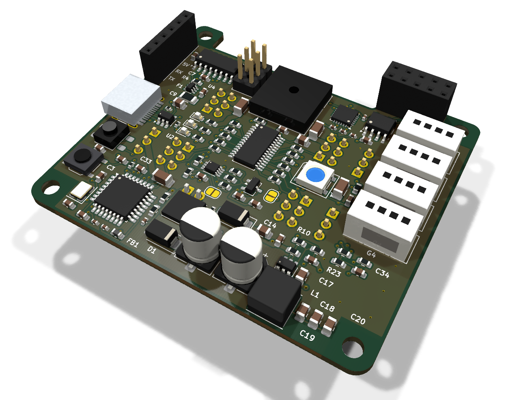
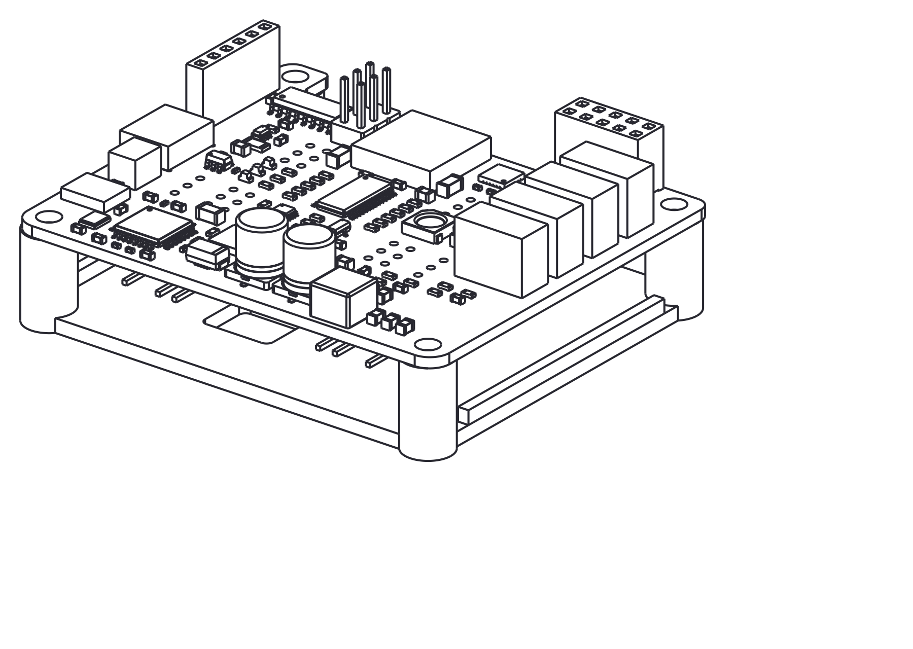
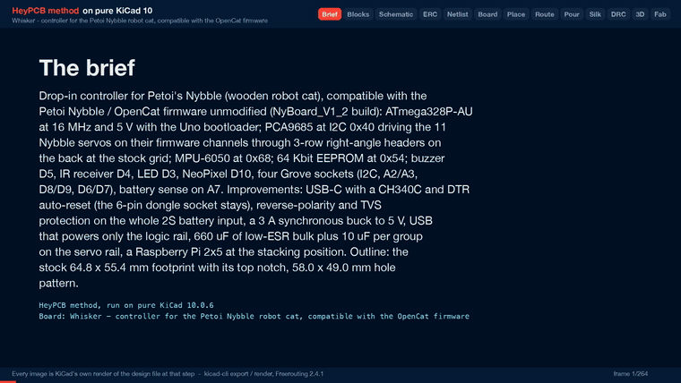

# Whisker

A drop-in controller for Petoi's Nybble robot cat that runs the stock OpenCat firmware, with USB-C, a 3 A buck and a protected battery input.

Part of [HeyPCB's open robot boards](https://github.com/HeyPCB). Designed end to end with the HeyPCB method on
KiCad 10 (headless pipeline, Freerouting 2.4.1); every number below is measured on the files in this repository.
Mentions of `./run.sh`, `docs/rules/`, `blocks/` or `parts/` refer to the heypcb-kicad SDK that produced them.

<p align="center"></p>
<p align="center"></p>

| Layers | Outline | Parts | Nets | Connections routed | Vias | ERC errors | DRC errors / unconnected / parity |
|---|---|---|---|---|---|---|---|
| 4 | 64.8 x 55.4 mm | 118 | 81 | 297 -> 0 open | 118 | 0 | 0 / 0 / 0 |

**Not fabricated, assembled or powered.**

| | |
|---|---|
| KiCad project | [`kicad/`](kicad/) |
| Gerbers (unzipped and zipped), BOM, CPL, STEP, schematic PDF | [`fab/`](fab/) |
| Printed parts (STEP/STL), CadQuery source, fit report | [`cad/`](cad/) |
| Renders | [top](media/top.png), [bottom](media/bottom.png) |
| Design process, every step as KiCad rendered it | [`media/design-process.mp4`](media/design-process.mp4) |

<p align="center"></p>

Whisker is a controller board for Petoi's Nybble robot cat. It is meant to drop in where the
stock NyBoard V1_2 sits: the same 58.0 x 49.0 mm hole pattern, the same outline with its top
notch, the servo headers at the stock grid on the back. It is **compatible with the Petoi Nybble /
OpenCat firmware** and needs no firmware change: an ATmega328P at 16 MHz and 5 V with the Uno
bootloader, a PCA9685 at 0x40, an MPU-6050 at 0x68 and a 64 Kbit EEPROM at 0x54, every peripheral
on the MCU pin the `NyBoard_V1_2` build expects. Whisker is an independent design. It is not a
Petoi product, and no Petoi schematic, layout or artwork was used.

It was designed with the HeyPCB method on KiCad 10. The headless heypcb-kicad pipeline (KiCad
10.0.6, Freerouting 2.4.1) built it from the brief in `board.json`. The facts it rests on (pin
map, addresses, servo channels, hole pattern, outline, connector positions) come from the
research spec `robots/research/cat/spec.md`, which cites the OpenCat sources and the photo and
STL measurements behind each one.

**This board has not been fabricated, assembled or powered, and it has not run the firmware.**
Firmware compatibility rests on the pin map below, not on a test. Every gate number here is read
from `report.json` of the final run (2026-10-02). Copper, edge and pour figures were
read from `kicad/whisker.kicad_pcb` with KiCad's pcbnew. Fit figures are read from
`cad/fit.json`.

## What it is

- **MCU:** ATmega328P-AU (TQFP-32) with a 16 MHz crystal, 5 V. AVCC sits behind a ferrite, because AVCC is the reference for the battery reading. There is a reset button at the rear edge and a 2x3 ICSP header for burning the Uno (Optiboot) bootloader once.
- **Servos:** a PCA9685PW at I2C 0x40 (all address pins low, OE low, internal oscillator). It drives the 11 Nybble joints on their firmware channels, each through 1k. The ports are 3-row right-angle headers on the back at the stock grid, with GND toward the board edge. Each header group has 10 uF on the rail.
- **IMU and storage:** an MPU-6050 at 0x68, turned 180 degrees like the stock part, with INT on D2. An AT24C64D EEPROM at 0x54 holds the skills.
- **I2C:** a PCA9306 joins the 5 V MCU bus to the 3.3 V bus (the PCA9685, MPU-6050, EEPROM, Grove G1 and the Pi header). There are 2.2k pull-ups on each side for the firmware's 500 kHz clock. A solder jumper, PI I2C, lets the MCU release the bus to a Raspberry Pi.
- **USB-C:** a CH340C behind a USBLC6-2SC6, with DTR auto-reset through 100 nF. The CH340C's TXD reaches RX through 1k, so a dongle can still drive RX.
- **6-pin socket:** kept for the BT and WiFi dongles, in the Pro Mini order (DTR, TX, RX, 5V, NC, GND), with its own DTR auto-reset. It is a vertical 1x6 socket; the stock one lies flat (see *Departures*).
- **Battery input:** a keyed JST XH socket on the back for the 2S pack. An AON6411 P-FET blocks a reversed pack for the whole board, servo rail included. An SMAJ10A clamps the protected rail. The servo rail VBAT has 2 x 330 uF low-ESR electrolytics and 4 x 10 uF ceramics.
- **5 V:** a TPS563201 synchronous buck (3 A) fed from VBAT through an SS34, with a 4.7 uH inductor and an 82k / 15k divider: 0.768 V x (1 + 82/15) = 4.97 V. TI's 5 V table (SLVSD90B Table 7-2) gives 54.9k / 10k; 82k and 15k are both pinned Basic parts.
- **USB power:** USB reaches the 5 V rail only, through a 500 mA PTC and an LM66100 ideal diode (CE on its own output). If the buck's body diode back-feeds its input from USB, the SS34 stops it, so USB never powers the servos.
- **3.3 V:** an XC6206 LDO off 5 V.
- **Peripherals:**
  - a 12 x 12 mm piezo on D5 (tone()), through 100 ohm;
  - an IRM-H638T 38 kHz receiver on D4;
  - a green LED on D3;
  - one WS2812B on D10;
  - blue 5 V and orange servo-rail LEDs;
  - battery sense on A7 through a 20k / 20k divider (the firmware's 1:2).
- **Grove:** four HY2.0 (Grove-compatible) sockets on the front edge:
  - G1: I2C, 3.3 V logic;
  - G2: A2 / A3;
  - G3: D8 / D9;
  - G4: D6 / D7.
- **Raspberry Pi:** a 2x5 socket where a face-to-face Pi's pins 1-10 land.
  - 5 V and GND;
  - SDA and SCL on the 3.3 V bus;
  - the Pi's TXD to RX through 1k;
  - TX to the Pi's RXD through a 1k / 2k divider;
  - GPIO4 to RESET through 100 nF.
- **Board:** 4 layers, 64.6 x 55.2 mm, 1.6 mm thick in the gerber job. The stackup is:
  - F.Cu, signals and a GND pour;
  - In1, signals and a 5 V pour;
  - In2, signals and a VBAT pour;
  - B.Cu, poured GND. It carries 132 mm of track, so it is almost a solid plane.

  There is no plane while routing; see *Departures from the spec*.

## Firmware pin map

The MCU pins, read back from the run's netlist (`design.json`). Firmware sources are listed in the spec, section 1.4.

| ATmega328P pin | Arduino | Net | Function (OpenCat `NyBoard_V1_2`) |
|---|---|---|---|
| 30 / 31 | D0 / D1 | RXD / TXD | serial, 115200 Bd: CH340C (RX through 1k), the 6-pin socket, the Pi (RX through 1k, TX through a divider) |
| 32 | D2 | IMU_INT | MPU-6050 INT (wired; the firmware leaves it unused) |
| 1 | D3 | LED_D3 | green status LED (`LED_PIN 3`) |
| 2 | D4 | IR | IR receiver (`IR_PIN 4`) |
| 9 | D5 | BUZZER | piezo (`BUZZER 5`, tone()) |
| 10 / 11 | D6 / D7 | D6 / D7 | Grove G4 |
| 12 / 13 | D8 / D9 | D8 / D9 | Grove G3 |
| 14 | D10 | NEOPIXEL | WS2812B data, through 330 ohm |
| 15 / 16 / 17 | D11 / D12 / D13 | MOSI / MISO / SCK | ICSP |
| 25 / 26 | A2 / A3 | A2 / A3 | Grove G2. A3 also reaches PCA9685 channel 3 through the open CAL jumper (`PWM_READ_PIN A3`) |
| 27 / 28 | A4 / A5 | SDA5 / SCL5 | I2C, through the PCA9306 to the 3.3 V bus |
| 22 | A7 | VBAT_SENSE | battery divider, 1:2 (`VOLTAGE_DETECTION_PIN A7`, `LOW_VOLTAGE 650`) |
| 29 | RESET | RESET | 10k pull-up, reset button, ICSP; DTR of the CH340C and of the 6-pin socket, and the Pi's GPIO4, each through 100 nF |
| 23, 24, 19 | A0, A1, A6 | none | unused by the V1 firmware, left open |

| I2C device | Address | How it is set |
|---|---|---|
| PCA9685 | 0x40 (All-Call 0x70 also answers) | A0-A5 grounded |
| MPU-6050 | 0x68 | AD0 grounded |
| AT24C64D | 0x54 | A2 high, A1 and A0 low. Petoi's block diagram says 0x51; the text, the V1_2 silkscreen and the firmware say 0x54, and the spec resolves the conflict that way |

**Servo ports.** The channel map is OpenCat's `pwm_pin[]` for NyBoard V1_x (spec 1.6).

- **Columns:** spec board frame, x toward the head. Whisker puts them on an exact 2.54 mm grid from the photo's first columns: 11.26 / 13.80 / 16.34 / 18.88 on the rear half and 40.90 / 43.44 / 45.98 / 48.52 on the front half. The photo measured 11.26 / 13.79 / 16.32 / 18.85 and 40.90 / 43.45 / 46.00 / 48.55 (spec 1.6), within 0.03 mm.
- **Rows:** PWM is the inner row and GND the row nearest the edge. The lower groups (robot's right) sit at y 23.0 / 20.46 / 17.92; the upper groups (robot's left) at y 33.2 / 35.74 / 38.28. The photo measured 23.0 / 20.45 / 17.9 and 33.2 / 35.7 / 38.25.

| Joint | Name | PCA9685 ch | Group | Column x | Header | Silk (back) |
|---|---|---|---|---|---|---|
| 0 | head pan | 12 | upper front | 48.52 | J16 | PAN |
| 1 | head tilt | 11 | lower front | 48.52 | J14 | TILT |
| 2 | tail | 4 | lower rear | 11.26 | J10 | TAIL |
| 8 | left front shoulder | 14 | upper front | 43.44 | J15 | LF SHLD KNEE |
| 12 | left front knee | 15 | upper front | 40.90 | J15 | (same) |
| 9 | right front shoulder | 9 | lower front | 43.44 | J13 | RF SHLD KNEE |
| 13 | right front knee | 8 | lower front | 40.90 | J13 | (same) |
| 10 | right hind hip | 6 | lower rear | 16.34 | J11 | RH |
| 14 | right hind knee | 7 | lower rear | 18.88 | J11 | (same) |
| 11 | left hind hip | 1 | upper rear | 16.34 | J12 | LH |
| 15 | left hind knee | 0 | upper rear | 18.88 | J12 | (same) |

Channels 2, 3, 5, 10 and 13 are unused on Nybble, and their positions are left empty. Channel 3 can feed A3 for the firmware's oscillator calibration once the CAL jumper is bridged.

## Departures from the spec

| Spec or request | On the board | Why |
|---|---|---|
| DMP3013SFV reverse-polarity FET | AON6411 (C81007), -20 V, DFN-8 at 1.27 mm pitch | The PowerDI3333 land puts the gate pad 0.65 mm from a source pad. A 1.0 mm servo-rail track cannot reach source pins 2 and 3 at 0.2 mm clearance; Freerouting runs without neck-down. |
| Passive buzzer on a 2N7002 (stock), MLT-8530 suggested | PKLCS1212E4001 12 x 12 mm piezo, driven from D5 through 100 ohm | KiCad 10 has no land for the MLT-8530 (spec 6). A piezo is a capacitive load and needs no driver or flyback diode. It is 3 mm tall. |
| WS2812C-2020 on KiCad's WS2812B-2020 symbol, "check the pin-out" (spec 6) | WS2812B 5050 (WS2812B-B/T, C2761795) | The repository's rules bind a part only to the symbol for its own package. The 5050 is the part KiCad's `LED:WS2812B` symbol and land are drawn for (pins 1 VDD, 2 DOUT, 3 VSS, 4 DIN), so no pin-out needs checking. |
| I2C master slide switch, kept (spec 4, item 13) | PI I2C solder jumper | The master is chosen once per build, so copper does it, with no part to source or place on the crowded front. Open (the default) keeps the MCU as master. Bridged, it grounds the PCA9306's EN, so a Pi on the 2x5 drives the bus alone. |
| Pi GPIO4 to RST (spec 1.2; no circuit given) | GPIO4 through 100 nF to RESET | A falling edge resets the MCU, as DTR does. A static level, high or low, does nothing. |
| 1x6 female socket lying flat, opening toward +y (stock, spec 1.7) | vertical 1x6 socket (C40877) on KiCad's `PinSocket_1x06_P2.54mm_Vertical` land, within 0.3 mm of the photo's pin positions | Not matched. A dongle plugged in stands up from the board instead of lying along it; see *Check before ordering*. |
| 3-row x 4 right-angle headers | per group, one 2-column and one 1-column land (or one 2-column): KiCad's straight 2x3 / 1x3 lands, on the back, holding a 3-row right-angle header snapped from a 3x3 (PZ254-3-03-W-2.5-G0) | KiCad 10 has no 3-row right-angle land. Separate 1x3 lands at 2.54 mm overlap courtyards. Omitting the five unused channels leaves a pair plus a single per group. |
| Grove sockets at 10.4 mm pitch, plus a 2.54 mm break-out column | sockets at 7.0 mm pitch with their pins along x; no break-out column | At the stock pitch, KiCad's Grove land's 11.4 mm courtyard overlaps its neighbour. The freed lower-right corner holds the Pi's level-shift parts. An 8 mm pitch was tried, and its route left a GND pin open. |
| Notch at least x 6.5-45.1 (spec 2.7) | notch x 6.4-44.8, floor at y 49.6 | The Pi socket sits at the Pi's own pin positions. Its pads keep the 0.5 mm copper-to-edge clearance only with the notch's right edge at 44.8, 0.1 mm inside the photo's 44.9. |
| In1 as the GND plane (the pipeline's default) | no plane while routing; In1 poured 5 V, In2 VBAT, B.Cu GND afterwards | Freerouting mirrors a back-side part's layers. The servo headers' through-hole pins then reach the router with an In1 shape, and Freerouting never joined same-net pin pairs on them (26 and 30 open). With no plane, 297 connections routed to 0. See `docs/rules/pipeline.md`. |

## Measured gates (final run, 2026-10-02, from `report.json`)

| Gate | Result |
|---|---|
| Composition | 31 block instances of 20 blocks (18 new `whisker_*` blocks and HeyPCB's `gpio_led` and `led_indicator`) give 118 parts, 81 nets and 5 explicit no-connects |
| Part binding (`parts/lcsc_pinned.json`) | 112 of 118 parts bound, 0 unsourced, 0 identity conflicts. Two solder jumpers and four holes have nothing to buy. 54 distinct part numbers: 27 Basic, 27 Extended (about $81 in JLC loading fees) |
| ERC (`kicad-cli sch erc --severity-all`) | 0 errors, 0 warnings |
| Netlist round trip | identical, 81 nets |
| Placement | 118 parts, every one locked by the brief. No same-face courtyard overlap and no through-hole inside a courtyard (checked on the placed board before routing) |
| Routing | 297 → **0 open** on rung 2. Rung 1 left 3 open with fanout and 12 without. Rung 2 narrowed the PWR5 class (5V, VBUS, VBUS_F) to 0.2 mm, and its last-mile router closed the battery pin to FET drain hop and one GND link, both kept by DRC. 1181 tracks, 109 routing vias, 2676.6 mm of track: F.Cu 835.9, In1 874.1, In2 834.7, B.Cu 132.0 |
| Pours (only after a measured 0 open) | GND on F.Cu and B.Cu, 5V on In1, VBAT on In2. 10 stitching vias (119 vias in all). 0 open after the pour, after stitching and at the end |
| Silkscreen | 11 words, 7 pin labels and 4 title lines placed. 1 stitching via displaced, 20 designators seated and 87 hidden |
| DRC (`--severity-all --schematic-parity`, KiCad 10.0.6) | fresh, **0 errors, 0 unconnected, 0 parity**, 4 warnings |
| DFM (`jlcpcb_4layer`) | 0 errors, 1 warning: 422 stock-footprint silk strokes at 0.12 mm, which the fab prints at its 0.15 mm minimum |
| Fab gate | **ready**, no blockers. Four copper gerbers, gerber job `LayerNumber` 4. The JLC CPL corrected 9 rotations |
| Media | 63 3D frames, the raytraced renders and the design-process video (1920 x 1080, 179.2 s, 5375 frames by ffprobe) |

**The 4 DRC warnings:**

- `lib_footprint_mismatch` on J9 (the Pi socket) and J2 (USB-C): the board's copies differ from KiCad's library footprints. These are the two footprints at the board edge, where the silk stage clips footprint silk (7 items clipped in this run).
- `silk_over_copper`: JP1's outline arc touches the back battery socket's pin-2 pad.
- `silk_over_copper`: the WS2812B footprint's "1" touches C37's rail pad.

## Copper and power paths

Read from the final `.kicad_pcb` with pcbnew. Current figures use heypcb-kicad's `route.ipc2221_amps` at a 10 C rise. The vias are rated as a 25 um barrel, the way the Spinner README rates its own.

- **Battery feed (BAT_RAW, pack to FET drain): 6.5 mm on F.Cu, 1.5-2.0 mm wide, no via.** The FET's drain pad sits 0.7 mm below the battery pin, so the hop is about 2 mm long.
  - 2.0 mm of 1 oz outer copper carries about 3.9 A; 1.5 mm carries about 3.2 A.
  - The class has `currentA` 5, so the ladder may not narrow it.
- **Servo rail (VBAT): 1.0 mm tracks** with three 0.8 / 0.4 mm vias:
  - F.Cu 48.5 mm, In1 58.6 mm, In2 25.4 mm, B.Cu 16.5 mm;
  - plus the In2 VBAT pour (1963.4 mm² after fill, 8 islands).
  - 1.0 mm is about 2.4 A on 1 oz outer copper, 1.2 A on 1 oz inner and 0.7 A on 0.5 oz inner. A 0.4 mm via is about 2.2 A.
  - The pack's stated peak is 5 A and its typical draw 2 A (spec 3.2). Where the rail runs as a track rather than inside the In2 pour, a 5 A stall peak exceeds the track rating; see *Check before ordering*.
- **5 V: 0.2 mm tracks** (the class narrowed by the ladder), 11 vias:
  - F.Cu 61.2, In1 79.4, In2 116.5, B.Cu 11.0 mm;
  - plus the In1 5 V pour (2055.4 mm², 8 islands), which reaches the Pi socket's 5 V pads, the Grove, ICSP and dongle 5 V pins.
  - The Pi's 5 V pins are on the socket's outer row, against the lobe edge. Between the inner-row pads (0.84 mm gaps) and the edge, only a track of about 0.24 mm, or a pour neck, gets to them. So a Pi can draw far less than the buck's 3 A here; see *Check before ordering*.
- **Buck:** VBUCK and the switch node are 0.6 mm (about 1.65 A on 1 oz outer copper per track), each with two vias.
- **Ground:** B.Cu is one 2584.3 mm² island of GND around 132 mm of track. The F.Cu GND pour is 1975.9 mm² in 7 islands.
- **Edges:** the nearest bodies to the outline are:
  - the USB-C shell, 0.6 mm proud of the rear edge by design;
  - the Pi socket, 0.04 mm inside the notch edge at the Pi's pin positions;
  - L1, 0.65 mm;
  - the piezo, 0.85 mm.

  Every other body is at least 0.95 mm inside the photo-measured outline, which is uncertain by +-0.5 mm.

## Silkscreen

- **Front:**
  - G1 I2C above the first Grove socket and G4 below the last;
  - PI beside the Raspberry Pi socket;
  - the dongle socket's 5V, RX and TX names.
- **Back:**
  - each servo group's joints: TAIL, RH, LH, RF SHLD KNEE, LF SHLD KNEE, PAN, TILT;
  - BATT 2S;
  - the dongle socket's NC, 5V, RX and TX;
  - the title "Whisker", "Nybble / OpenCat compatible", "rev A heypcb-kicad", "not fabricated".
- **Words that found no spot:** the front is packed. USB, RESET, ICSP, G2, G3, IR, the LED names, the two jumpers and the ICs found no free spot on any ring the silk stage tries (each candidate was tested before the brief was settled), so the brief does not ask for them. The LEDs are told apart by colour: orange is the servo rail, blue is 5 V, green is D3. The dongle socket's DTR and GND names landed on neither face.

## The printed cradle (`cad/mount.py`)

A tray that clamps Whisker to Nybble's y1 rails and guards the parts on its back.

- **Geometry:** four 7 mm bosses (the seat the spec asks for), bored 2.4 mm and counterbored underneath. They stand on a 2 mm floor whose top sits 10.5 mm below the board. That clears every body on the back by at least 2 mm: the lowest is the right-angle servo header envelope, at 8.02 mm.
- **Floor outline:** the board polygon inset 1 mm, cut open under the battery socket for its plug and cable, with a window under the PCA9685 and stiffening lips along the two short ends. Nothing stands at the long edges, where the servo plugs leave sideways.
- **Fastening:** an M2 self-tapping screw, about 16 mm, goes up through boss, board and into the y1 pilot hole (Petoi's screw B also fits the bore). The board is clamped between the rail bosses and the cradle.
- **Inputs:** `mount.py` reads the board's real STEP (`fab/whisker.step`, by reference designator), its footprints through pcbnew, and the frame facts of the spec (sections 2.3-2.6 and 5).
- **Output:** 7379.5 mm³, about 9.4 g in PETG. The STL is watertight (trimesh).

Fit, measured with OpenCascade's `BRepExtrema_DistShapeShape` (`cad/fit.json`):

| Pair | Minimum | Note |
|---|---|---|
| Cradle to every body below the board (11 parts) | **1.22 mm** (J9's pin tails), 1.50 mm (J8's) | the servo header envelopes are 2.48 mm above the floor; no interference |
| Cradle to the mated servo plugs | 2.48 mm | plugs above the floor; they leave past the board's long edges |
| Cradle to the battery plug | 1.50 mm | around the floor opening |
| Cradle to the board body | 0 (contact) | only at the four boss seats (136 mm²); common volume 0.0 mm³ |
| Rails (rebuilt) to the board's top-side bodies (105 parts) | **0.10 mm** (J9), 0.20 mm (C20), 0.68 mm (Y1), 0.93 mm (L1) | each is 3.6-10.2 mm from a hole centre, outside the 7 mm seat; the near ones meet the rebuilt boss, not the seat |
| Rails to the cradle | 1.51 mm | the board lies between them |
| Cradle to the belly (rebuilt) | 4.39 mm | lowest board part 8.87 mm, battery plug housing 4.81 mm |

**What these numbers rest on:**

- **Rebuilt, not measured, robot frame.** The spec's STL measurements give:
  - y1 rails 3 mm thick, inner edge X = 28, narrow section X = 28-34.5;
  - bosses reaching in to X = 22.5;
  - 1.4 mm pilot holes at X = +-24.52, Z = +-29 / +-41;
  - an 18.4 mm gap from y1 down to the belly.

  The STLs carry no licence and are not used here. The boss outline is this script's guess: a 7 mm disc plus a bridge to the rail, cut at X = 22.5. The belly gap rests on the spec's shared-frame assumption.
- **Envelopes for parts with no STEP model:**
  - the 3-row right-angle headers (from the PZ254-3-03-W-2.5-G0 catalogue row: 2.54 mm pitch, 2.5 mm insulator, 6 mm pins; standoff and bend gap estimated), which replace the lands' straight-header models;
  - servo plugs 14 mm long (spec 5, estimated);
  - the battery plug 5 mm below its housing (spec 2.4, estimated);
  - envelopes from catalogue heights or estimates for the Grove sockets, USB-C, piezo, reset switch, IR receiver and MPU-6050.

  `fit.json` lists every assumption.

Previews (CadQuery SVG, converted with rsvg-convert), all in `cad/`:

- `cradle_iso.png` and `cradle_top.png`;
- `board_on_cradle_iso.png` and `board_on_cradle_under.png`;
- `fit_iso.png` (with the rails), `fit_side.png` and `fit_end.png`.

## Check these before ordering

The board passes ERC, the netlist round trip, routing, DRC (errors, unconnected and parity), DFM and the fab gate in KiCad. None of it has been built.

**Fit in the robot**
- **The outline is photo-measured:** +-0.5 mm on edges, +-0.3 mm on spacings, from a NyBoard V1_1 photo scaled by its header pitch (spec 2.1-2.2).
  - The 58.0 x 49.0 mm hole pattern is the solid number; the photo, the STL and the Pi standard agree on it.
  - Measure a real NyBoard's width, both top heights (55.4 vs 56.0 in the photo), the notch (x 6.7-44.9, floor 49.9) and its corner radii before ordering.
  - Whisker's notch runs x 6.4-44.8, which is 0.3 mm narrower on the right than the spec recommends.
- **The y1 bosses.** The Pi socket (0.10 mm) and C20 (0.20 mm) are the closest bodies to the rebuilt rail bosses, whose outline is a guess. Look at the real y1 bosses next to those two parts before ordering.
- **The dongle socket stands upright.** The stock 1x6 socket lies flat with its opening toward the notch, so a plugged dongle rises about 10 mm (spec 2.4). On Whisker the socket is vertical, so a dongle stands up by its own length. Check that it clears the robot's cover, or change J8 to a right-angle socket before ordering.
- **USB-C access** at the tail edge has not been checked against the frame (spec 8). The shell stands 0.6 mm proud of the rear edge.
- **Heights on top:**
  - Grove sockets 8 mm (catalogue row);
  - the dongle and Pi sockets 8.5 mm;
  - the bulk capacitors 7.7 mm.

  The spec estimates the stock board's tallest top part at 6-7 mm. A Pi stacked on the 2x5 sits over the bulk capacitors; that clearance was not checked.
- **The space under the board** (about 16.9 mm from the board to the rebuilt belly) is an estimate from the STLs' shared frame (spec 8, item 2). The cradle leaves 4.39 mm of it.

**Firmware-visible choices**
- **MPU-6050 orientation.** U9 is turned 180 degrees: the spec's reading of the stock board's photo, which it lists as unconfirmed (spec 8, item 3). The firmware applies no axis remapping. Check on a real NyBoard (spec 1.7: print with token `v`, tilt nose-down and left-side-down) and turn U9 to match if it differs.
- **The 6-pin socket's order** follows the V1_1 photo and the Arduino Pro Mini (TX next to DTR, pin 5 NC). Petoi's text lists 2 RX / 3 TX and pin 5 GND. Check against a dongle before plugging one in.
- **The piezo** resonates at 4 kHz and is quieter away from it; OpenCat's melodies sit mostly below 4 kHz. Listen to one before committing to it.
- **I2C at 500 kHz** with 2.2k on each side of the PCA9306: check the rise time with Grove modules on the bus.
- **Crystal load:** 12 pF caps for the X322516MLB4SI's 9 pF load (catalogue row). Check the oscillation margin.

**Current**
- **Servo rail.** The 1.0 mm VBAT tracks rate about 2.4 A on outer copper and 1.2 A on 1 oz inner copper. The In2 pour carries the rest between the header groups. All eleven servos stalling at once draw up to the pack's 5 A. Widen the F.Cu and In1 VBAT runs between the bulk capacitors and the groups if the robot runs hard, and choose 1 oz inner copper when ordering.
- **5 V for a Pi.** The buck delivers 3 A, but the 5 V copper is 0.2 mm tracks and the In1 pour, and the Pi's 5 V pins are reachable only through 0.84 mm gaps between the socket's inner-row pads. A Pi 3A+ at its typical draw is plausible; a heavier Pi is not supported. With USB alone, the 500 mA PTC cannot power a Pi.
- **Reverse polarity.** The AON6411's gate sees -8.4 V from a full 2S pack. One LCSC listing of the same MPN (C52205210) gives +-12 V for it; check AOS's datasheet.
- **The TVS (SMAJ10A)** stands off 10 V and clamps at 17 V (catalogue row), under the AON6411's 20 V.

**Parts and assembly**
- **Servo headers.** Fit a 3-row right-angle header snapped from a 3x3 (PZ254-3-03-W-2.5-G0) into each land from the back, pins pointing out toward the robot's side, GND row outermost. The lands are KiCad's straight 2x3 / 1x3, and the 3D renders show their straight-pin models. The cradle fit check uses the right-angle envelope instead.
- **Grove.** The ZX-HY2.0-4PZZ sits on KiCad's NS-Tech Grove land. Its pins and pegs were not checked against the ZX drawing.
- **Missing 3D models.** KiCad 10.0.6 installs no 3D model for the Grove land, the IRM-H6xxT, the piezo, the reset switch or the MPU-6050 QFN. The renders show them as lands only. The IR receiver's lens direction is not recorded here; check that it looks out of the rear edge.
- **MPU-6050.** It is obsolete / NRND at TDK (spec 4). Buy the build quantity now.
- **Part numbers and stock.**
  - Every part number in `fab/whisker_bom.csv` comes from `parts/lcsc_pinned.json`: 29 rows were looked up live on 2026-10-02 and the rest are older pinned rows (2026-06-23 to 2026-09-30).
  - The lowest stock is the AON6411 (2346), then the PCA9685 (2772) and the right-angle header (3559).
  - Stock and Basic/Extended class change daily; re-check before ordering.
- **Stackup.** The gerber job lists KiCad's default 4-layer stackup: 35 um copper and 0.48 mm FR4 x 3. Choose the inner copper weight when ordering.

## Licence and attribution

- **OpenCat firmware.** OpenCat (github.com/PetoiCamp/OpenCat-Quadruped-Robot) is MIT-licensed: "Copyright (c) 2022 Rongzhong Li" and Petoi LLC. Whisker contains none of its code. The pin map, I2C addresses and servo channel map above are facts read from it and cited in the research spec. Keep OpenCat's copyright and permission notice when redistributing the firmware for this board.
- **Petoi hardware.** The NyBoard's schematic, layout and gerbers are not published under any licence. Whisker is therefore an independent, functionally and mechanically compatible design built from facts: the pin map, addresses, dimensions and connector positions.
  - No Petoi layout, schematic, silkscreen, artwork or logo was copied.
  - "Petoi", "Nybble", "NyBoard" and "OpenCat" are used only to say what this board is compatible with.
  - The Nybble frame STLs carry no licence; the cradle uses the spec's measurements of them, not the files.
- **KiCad libraries.** The symbols, footprints and 3D models are KiCad's (CC-BY-SA-4.0 with the KiCad library exception). The USB-C body is heypcb-kicad's generated envelope.
- **This repository** declares no licence of its own.

## Files

- `board.json`: the brief the pipeline built everything from.
- `cad/mount.py`: the cradle, its fit check and previews. It runs with a Python that has CadQuery and trimesh: `python cad/source/mount.py`.
- Built by the pipeline (not committed; `build/` is regenerated):
  - `report.json`;
  - `kicad/whisker.kicad_{sch,pcb,pro}`;
  - `fab/`: the gerber zip, BOM (55 rows), JLC CPL, positions, schematic PDF and STEP;
  - `build/whisker/render/0200_3d.png` (top) and `0201_3d.png` (bottom), plus the turntable frames;
  - `media/design-process.mp4`;
  - `cad/`: the cradle STEP and STL, the board-on-cradle STEP, `fit.json` and the previews.

## Reproduce

From the heypcb-kicad repository:

```bash
./run.sh --board boards/whisker --no-media   # every gate, 320 s of stages in the final run (routing 287 s)
./run.sh --board boards/whisker              # plus the 3D renders (230 s) and the video (31 s)
python cad/source/mount.py   # a Python with CadQuery and trimesh
```

Every part is locked by the brief, so placement is identical every run. The final brief routed
the same way twice on 2026-10-02 (`--no-media`, then the full run): 1181 tracks, 109 vias and
2676.6 mm both times.

## License

Hardware: [CERN-OHL-S v2](LICENSE). Files under `cad/` that derive from third-party CAD carry their own notice there.
